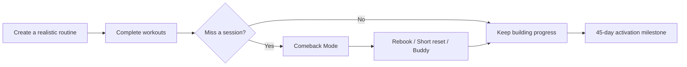
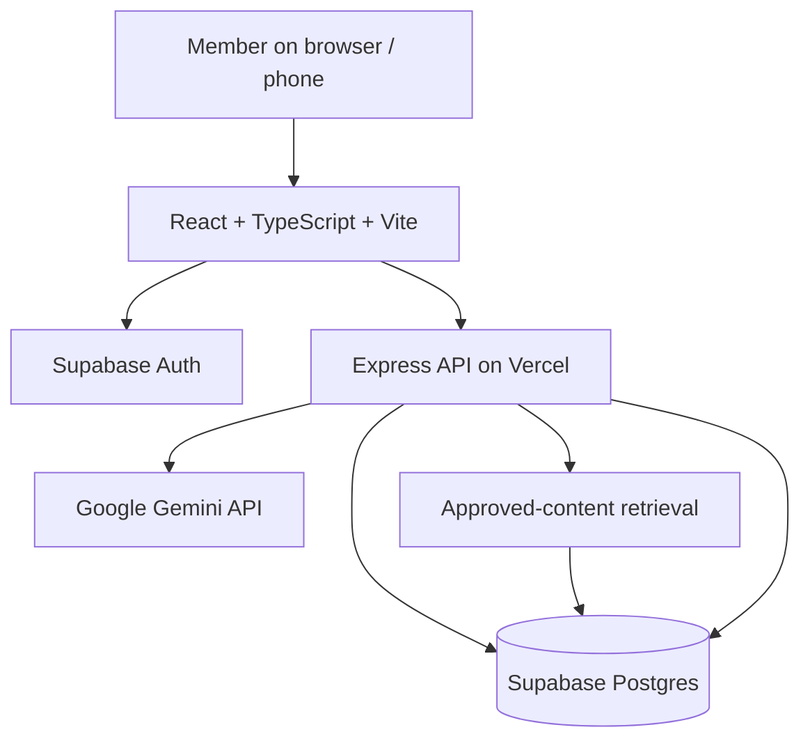

<div align="center">

# 🏋️ Routine Activation

### From fitness intent to a repeatable routine.

**A deployed, mobile-first fitness application built around a simple idea: missing a workout should not mean starting again.**

[](https://routine-activation.vercel.app/)
[](https://github.com/ericbabu20/routine-activation)
[](https://github.com/ericbabu20/routine-activation)


**[🌐 Try the live app](https://routine-activation.vercel.app/)** · **[💻 Explore the code](https://github.com/ericbabu20/routine-activation)** · **[📋 Original capstone PRD](PRD.md)**

</div>

> **Independent product disclaimer:** This is an independently developed fitness application and Airtribe Product Management capstone inspired by a routine-activation challenge involving cult.fit. It is **not an official cult.fit product**, has no affiliation or endorsement, and does not connect to real cult.fit membership, booking or payment systems. Any gym, plan or class records in the application are demonstration data.

---

## ✨ The idea

Most fitness apps are designed to help people **start**. Routine Activation focuses on what happens when real life interrupts the plan.

A missed workout often breaks momentum. Instead of punishing the member with a lost streak, the app retains completed progress and offers a manageable next step: **reschedule, choose a shorter workout or ask a trusted buddy for support**.

> **Product principle:** One missed workout does not erase your progress.

### 🎯 The 45-day activation goal

A member reaches the defined routine-activation milestone by completing:

- **8 or more eligible workouts**
- Across **4 or more distinct weeks**
- Within their **first 45 days**

The capstone used a **34% illustrative baseline and 50% six-month target** to frame the opportunity. These figures are **case-study assumptions, not measured outcomes from this app or published cult.fit performance**.

---

## 📱 Product screenshots

The images below are deliberately marked **placeholder**. Replace them with genuine screenshots from the deployed app, ideally after removing personal details and account information.

<table>
<tr>
<td align="center"><br /><strong>🏠 Home</strong><br />Daily overview and next action</td>
<td align="center"><br /><strong>🗓️ Routine Map</strong><br />Progress towards activation</td>
<td align="center"><br /><strong>🔄 Comeback Mode</strong><br />A practical restart after a miss</td>
</tr>
<tr>
<td align="center"><br /><strong>✨ AI Assistant</strong><br />Context-aware routine support</td>
<td align="center"><br /><strong>🤝 Trusted Buddy</strong><br />Optional, consent-based support</td>
<td align="center"><br /><strong>🥗 Nutrition</strong><br />Meal logging and daily targets</td>
</tr>
</table>

<!-- TO ADD REAL SCREENSHOTS:
1. Capture 6 redacted screenshots from the live product.
2. Save them under docs/screenshots/ (e.g. home.png, routine.png, comeback.png).
3. Change the corresponding  paths above to the new .png paths.
4. Remove the placeholder sentence above when all screenshots are real.
-->

---

## 🔍 Why I built this

This project began as an **Airtribe Product Management capstone (July 2026)**. I carried the work from problem discovery and solution prioritisation into a functioning web application.

My initial directional research included **16 survey respondents**. The signals were clear, but the sample was small and self-selected:

| Research signal | Directional finding |
|---|---|
| Low energy after work | 10 of 16 respondents described tiredness as a barrier |
| Restart difficulty | Only 1 of 16 said restarting after missed days was easy |
| Social support | 12 of 16 wanted support from a friend or group |

These findings informed the product hypothesis: **improving recovery from a missed session may help users establish a repeatable routine**. Larger studies and real-world usage data are needed to validate that hypothesis.

### 🧭 My product approach

`Research → Problem framing → Prioritisation → MVP definition → UX design → Implementation → Deployment → Measurement → Iteration`

I defined the problem, prioritised the core recovery mechanism, developed the application using **Cursor**, integrated the backend and AI features, and deployed it on **Vercel**.

---

## 🚀 What the application includes

| Area | Implemented in the repository |
|---|---|
| 🔐 Member accounts | Supabase email/password authentication, Google OAuth integration, recovery flows, member profiles and protected API routes |
| 🧩 Member onboarding | Personal profile and routine preferences before entering the member experience |
| 🏠 Member experience | Home, Explore, Pass, Activity, Profile and related screens |
| 🏋️ Workouts | Workout catalogue, guided sessions and completion tracking |
| 🗓️ 45-day Routine Engine | Personalised scheduling, completed-workout progress, rescheduling and recovery support |
| 🔄 Comeback and Tired-Day modes | Small restart actions and shorter workout options when energy or momentum drops |
| 🤝 Trusted Buddy | Member-to-member invitations, support requests and explicit data-sharing controls |
| 🎟️ Membership and classes | Demo membership plans, class discovery/booking workflows and QR-based pass functionality |
| 🥗 Nutrition | Meal tracking, dietary preferences, calorie/macro targets and suggested meals; general information only |
| ✨ Gemini assistant | Server-side AI assistant with member-scoped tools, approved-content retrieval, privacy preferences and feedback |
| 🛡️ Data protection | Authenticated endpoints, ownership-scoped queries, Supabase row-level security policies and security test code |

**Implementation status is not the same as production validation.** The repository contains these capabilities, but third-party gym entry, actual membership fulfilment, payment collection and large-scale public usage are **not** claimed.

### 🔄 The core recovery loop



The underlying design deliberately **banks completed progress**. Missed sessions trigger recovery options, rather than resetting the member to zero.

---

## 🧠 How the AI assistant works

The assistant uses **Google Gemini through the Express backend**. The client does not hold the Gemini API key.

- **Member-aware:** Authenticated, permission-filtered tools can retrieve the current user's routine, bookings and progress.
- **Grounded support:** Retrieval of approved help, workout and policy content helps constrain factual answers.
- **Consent choices:** Members can choose personalised assistance, FAQ-only assistance or turn AI off; conversation-history retention is optional.
- **Bounded responsibilities:** Deterministic application rules, rather than AI-generated text, govern booking, eligibility and data access.
- **Failure handling:** Configurable timeouts, retries and quota-error responses are implemented.

The assistant is a **routine companion, not a doctor or a replacement for a qualified fitness professional**.

---

## 🏗️ Architecture and technology



| Layer | Technology | Responsibility |
|---|---|---|
| Frontend | React 18, TypeScript, Vite | Responsive user interface and client-side flows |
| UI | Tailwind CSS, Radix UI, Lucide | Components, styling and icons |
| API | Node.js, Express | Member-scoped business logic and AI orchestration |
| Data and identity | Supabase (Postgres + Auth) | Authenticated accounts, application data and RLS |
| AI | Google Gemini (`@google/genai`) | Conversational assistance, embeddings and retrieval |
| Hosting | Vercel | Static frontend plus serverless API entry point |
| Development workflow | Cursor, GitHub | AI-assisted implementation and version control |

### 📁 Repository layout

```text
routine-activation/
├── api/                    # Vercel serverless entry point
├── server/
│   ├── routes/             # Feature API endpoints
│   ├── lib/                # Business rules, Gemini and RAG helpers
│   └── middleware/         # Authentication guard
├── src/
│   ├── pages/              # Member screens, onboarding, AI, routines
│   ├── components/         # Shared UI components
│   └── lib/                # Browser API, auth and data helpers
├── supabase/migrations/    # Database schema and security policies
├── scripts/                # Migrations, seed data and knowledge ingestion
├── tests/                  # Security test suite
├── docs/screenshots/       # Screenshot placeholders; replace with real captures
├── .env.example            # Configuration template (no real secrets)
├── vercel.json             # Deployment configuration
└── package.json
```

---

## 🛠️ Run locally

### Prerequisites

- Node.js 20+ recommended
- A Supabase project with database and authentication enabled
- A Gemini API key to enable the assistant (optional for non-AI flows)

```bash
git clone https://github.com/ericbabu20/routine-activation.git
cd routine-activation
npm install
cp .env.example .env
```

Edit `.env` with your own Supabase project details. The repository's `.env.example` documents all variables. The main ones are:

```dotenv
VITE_SUPABASE_URL=https://YOUR-PROJECT.supabase.co
VITE_SUPABASE_PUBLISHABLE_KEY=YOUR_PUBLIC_KEY
SUPABASE_URL=https://YOUR-PROJECT.supabase.co
SUPABASE_PUBLISHABLE_KEY=YOUR_PUBLIC_KEY
SUPABASE_SECRET_KEY=YOUR_SERVER_ONLY_SECRET_KEY
DATABASE_URL=YOUR_POSTGRES_CONNECTION_STRING
GEMINI_API_KEY=YOUR_GEMINI_API_KEY
```

**Never commit `.env`, the Supabase secret/service-role key, your database password or a Gemini API key.** The `VITE_` variables are browser-visible; secret keys must remain exclusively server-side.

Create the schema and seed the demonstration catalogue:

```bash
npm run migrate   # Requires DATABASE_URL
npm run seed      # Loads demonstration centres, plans and related reference data
npm run dev
```

Open **http://localhost:5173**. The Vite development server proxies API requests to Express on `http://localhost:3001`.

To populate the approved AI knowledge base, once Gemini credentials are configured:

```bash
npm run ingest
```

Other useful commands:

```bash
npm run build          # Production frontend build
npm run start          # Run the Express production server locally
npm run test:security  # Cross-user access and RLS tests; needs a configured DB
npm run db:status      # Check database setup
```

**Note:** This is a multi-service application. A fresh clone is not ready to run until Supabase credentials, migrations and appropriate seed data have been configured. Google sign-in also requires OAuth provider and redirect-URL configuration in Supabase.

---

## ☁️ Deployment

The app is deployed on **Vercel**, with the Vite build serving the frontend and `api/index.js` exposing the Express application through serverless functions.

For your own deployment:

1. Connect this GitHub repository to a Vercel project.
2. Configure the Supabase browser and server environment variables in Vercel.
3. Configure `GEMINI_API_KEY` and the AI model settings if the assistant is enabled.
4. Apply database migrations and populate reference data in Supabase.
5. Configure authorised URLs and authentication redirects for the deployment domain.
6. Deploy, then verify authentication, user-data isolation, core journeys and AI consent.

**Live application:** https://routine-activation.vercel.app/

---

## 📊 How success will be evaluated

The North Star metric is **45-day routine activation**, defined as 8 eligible workouts across 4 distinct weeks within the first 45 days.

| Measurement | Why it matters |
|---|---|
| Onboarding completion | Is the member able to create a realistic routine? |
| First workout within 7 days | Does intention convert into first action? |
| Missed-session recovery within 7 days | Does Comeback Mode help people return? |
| Week-2 workout participation | Does early behaviour repeat? |
| 45-day activation rate | Is a sustainable routine emerging? |
| Buddy consent revocation / negative feedback | Does accountability become intrusive? |
| AI feedback, errors and usage | Is the assistant genuinely useful and sustainable to operate? |

**No real pilot uplift or retention improvement is claimed yet.** The goal is to instrument and measure these outcomes as genuine members use the product.

---

## 🧪 Pilot and roadmap

### Current state

**Deployed MVP v1.1.** The codebase supports authenticated members and a Supabase-backed data model. A wider real-user rollout has **not yet been demonstrated**.

### Next: controlled pilot with up to 10 invited users

- Invite a small set of real testers and observe onboarding, routine creation, recovery journeys and usability.
- Check authentication and cross-user isolation before granting access.
- Capture qualitative feedback alongside product analytics.
- Track Gemini requests, token costs, API errors and deployment/database usage.
- Review privacy controls, account deletion, backups and retention handling.

### Scale only after pilot validation

- Resolve user-reported defects and accessibility issues.
- Move AI rate limiting to a shared, persistent store if traffic increases; the current in-memory limiter is not globally consistent across serverless instances.
- Add operational monitoring, alerts and database performance checks.
- Validate provider quotas, plan limits and costs before expanding beyond the pilot.
- Repeat security and load testing for the intended usage level.

> **10 users is a proposed pilot size, not a proven concurrent-user limit or a scalability benchmark.** Expansion will be based on demand and observed reliability.

---

## 👤 Creator and product ownership

**Eric Babu — Product Owner & Builder**

I developed Routine Activation as a product-management capstone and extended it into a working application. My contribution spans **problem discovery, user research, prioritisation, product requirements, UX decisions, AI-assisted coding in Cursor, Supabase integration, Gemini integration and Vercel deployment**.

The project is intended to demonstrate both **product judgement** (identifying the right problem and measuring outcomes) and **hands-on execution** (shipping a usable product).

[GitHub profile](https://github.com/ericbabu20) · [LinkedIn](https://www.linkedin.com/in/ericbabu)

---

<div align="center">

### A routine that survives real life.

**Built for the restart, not just the start.**

[🚀 Launch Routine Activation](https://routine-activation.vercel.app/)

</div>
